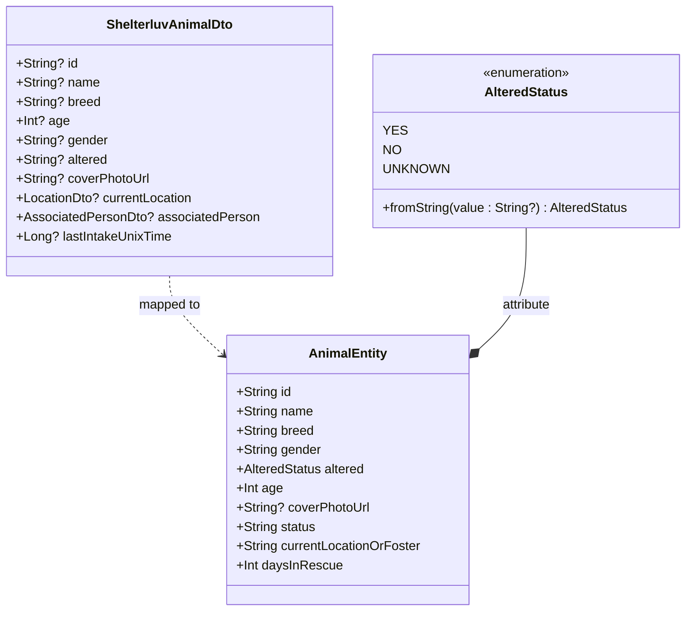
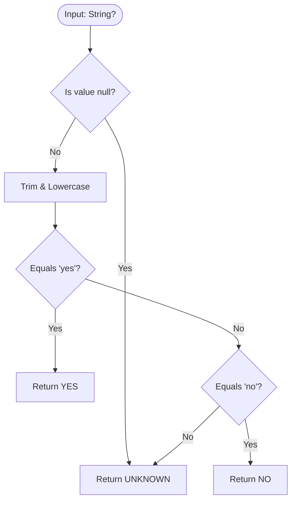
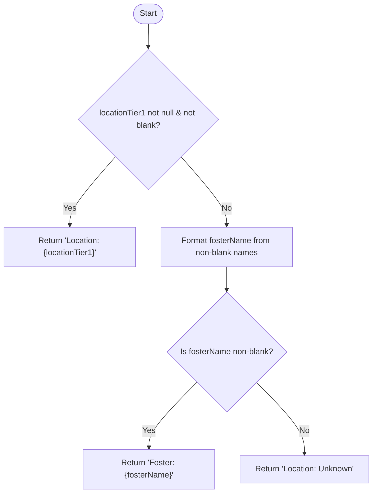
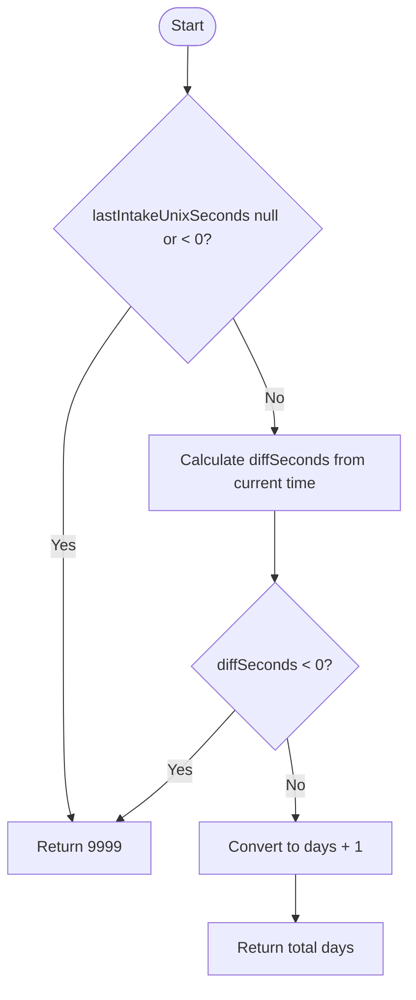

 [View Coverage Matrix](#5-coverage-matrix)

# Resqueue Data Layer (MVP)

A read-only Android data layer module that integrates with the ShelterLuv API to fetch, transform,
and cache animal profiles locally in Room.

*Note: This module serves as an MVP data layer to populate Resqueue with reliable data during early
development.
The data layer will eventually migrate to Firebase or AWS for full read-write capabilities, at which
point the
ShelterLuv integration will be deprecated.*

---

[1. Class Architecture](#1-class-architecture)  
[2. Mapping Logic](#2-mapping-logic)  
[3. Logic Flowcharts & Activity Diagram](#3-logic-flowcharts--activity-diagram)  
[4. Usage](#4-usage)  
[5. Coverage Matrix](#5-coverage-matrix)  

# Data Layer Mapping (`AnimalMapper.kt`)

## 1. Class Architecture


---

## 2. Mapping Logic
| Remote DTO Field (`ShelterluvAnimalDto`)  | Target Entity Property (`AnimalEntity`)   | Transformation Logic                                                                                  |
|:------------------------------------------|:------------------------------------------|:------------------------------------------------------------------------------------------------------|
| `id`, `name`, `breed`, `gender`, `status` | `id`, `name`, `breed`, `gender`, `status` | Direct mapping with `?: "Unknown"` fallback                                                           |
| `age`                                     | `age`                                     | Default fallback `1200 (100 years)` if null                                                           |
| `coverPhotoUrl`                           | `coverPhotoUrl`                           | Null fallback `R.drawable.ic_cover_photo_placeholder` caught by Coil                                  |
| `altered`                                 | `altered`                                 | Delegated to [`AlteredStatus.fromString()`](#31-enum-mapping-logic-alteredstatusfromstring)           |
| `currentLocation`, `associatedPerson`     | `currentLocationOrFoster`                 | Delegated to [`parseLocationOrFoster()`](#32-location--foster-assignment-logic-parselocationorfoster) |
| `lastIntakeUnixTime`                      | `daysInRescue`                            | Delegated to [`parseDaysInRescue()`](#33-days-in-rescue-logic-parsedaysinrescue)                      |

---

## 3. Logic Flowcharts & Activity Diagram

### 3.1 Enum Mapping Logic (`AlteredStatus.fromString`)



### 3.2 Location & Foster Assignment Logic (`parseLocationOrFoster`)



### 3.3 Days in Rescue Logic (`parseDaysInRescue`)



---

## 4. Usage

```kotlin
@HiltViewModel
class AnimalListViewModel @Inject constructor(
    private val repository: AnimalRepository
) : ViewModel() {

    private val _isLoading = MutableStateFlow(true)
    private val _errorMessage = MutableStateFlow<String?>(null)

    init {
        refresh()
    }

    val uiState: StateFlow<AnimalUiState> = combine(
        repository.animals,
        _isLoading,
        _errorMessage
    ) { animals, isLoading, error ->
        when {
            // Show error screen if fetch failed and local DB is empty
            error != null && animals.isEmpty() -> AnimalUiState.Error(error)
            // Show spinner while active initial fetch is in progress and local DB is empty
            isLoading && animals.isEmpty() -> AnimalUiState.Loading
            // Render content (or empty state message) once data arrives or fetch finishes
            else -> AnimalUiState.Success(animals)
        }
    }.stateIn(
        scope = viewModelScope,
        started = SharingStarted.WhileSubscribed(5000),
        initialValue = AnimalUiState.Loading
    )

    fun refresh() {
        viewModelScope.launch {
            _isLoading.value = true
            _errorMessage.value = null

            repository.refreshAnimals()
                .onSuccess {
                    // Animals refreshed successfully
                }
                .onFailure { error ->
                    _errorMessage.value = when (error) {
                        is DataException.NetworkError -> "No internet connection."
                        else -> "Failed to fetch animals."
                    }
                }

            _isLoading.value = false
        }
    }
}
```

---

## 5. Coverage Matrix

| File Name        |                                Line Coverage                                |                            Instruction Coverage                             |
|:-----------------|:---------------------------------------------------------------------------:|:---------------------------------------------------------------------------:|
| AlteredStatus    |  9/9   | 68/68  |
| AnimalMapper     | 37/37  | 44/44  |
| AnimalRepository | 11/11  | 93/93  |

Run `./gradlew koverHtmlReport` to generate the full HTML coverage report.